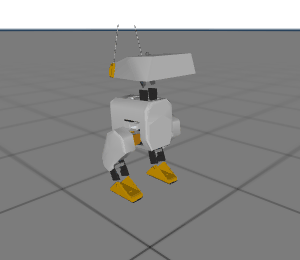
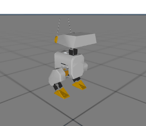
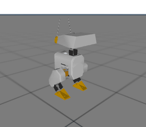

# Duck Motion Curation

Course project for **ROB6323: Reinforcement Learning and Optimal Control for Autonomous Systems** (NYU), by
Dhawal Kabra, Kanad Patel, Neer Patel and Pierrick Rugery.

**Question.** A common way to give a legged robot many skills is to train one RL policy that tracks a library of
reference motion clips. Real libraries contain bad clips, and ExBody2 proposed removing the ones a trained policy tracks
worst. But a clip's tracking error mixes how hard its motion type is with whether the clip is broken, so plain
curation can throw away hard, clean motions such as walking. We propose **type-normalised curation**, which judges each
clip only against clean clips of its own type. We test it in a controlled, pre-registered study on the open-source
[Open Duck Mini v2](https://github.com/apirrone/Open_Duck_Mini) biped in MuJoCo, against training on everything, random
removal, a kinematic check and plain curation, across several RL algorithms.

- **Preliminary report (2 pages):** [`report/preliminary_report.pdf`](report/preliminary_report.pdf)
- **Dataset:** [`data/`](data/), details and per-clip links in [`DATASET.md`](DATASET.md)
- **GIFs of every clip, by split:** [`gifs/`](gifs/)

## The motions

One clip of each of the 14 motion types (kinematic replay of the reference, real time):

| | | | |
|:---:|:---:|:---:|:---:|
|  walk forward |  walk backward |  side step |  turn in place |
|  walk and turn |  leg lift (kick) |  crouch |  bow |
|  sway |  head |  hop |  dance |
|  headbang |  twist | | |

Some of the most demanding clean clips:

| | | |
|:---:|:---:|:---:|
|  fast walk and turn |  fast, wide dance |  fast headbang |

## Dataset

221 clips at 50 Hz, at most 4 s each, 14 motion types: walk forward, walk backward, side step, turn in place, walk and
turn (gaits from the Placo walk generator of Open_Duck_Playground); leg lift (march, stomp, kick, tap), crouch, bow,
sway, head, hop, dance, headbang and twist (keyframed with inverse kinematics on the robot model). Every clean clip passes
kinematic checks (joint limits, servo speed, feet flat on the ground while in contact) and is no more demanding than the
generator's own walking gaits on servo lag and balance margin.

| split | clips | content | GIFs |
|---|---|---|---|
| train | 84 | clean, 6 per type | [`gifs/train/`](gifs/train/) |
| train (broken) | 25 | broken copies of clean train clips, 22.9% of train | [`gifs/train_broken/`](gifs/train_broken/) |
| validation | 42 | clean, 3 per type | [`gifs/val/`](gifs/val/) |
| test | 70 | clean, 5 per type, motion sources never used in training | [`gifs/test/`](gifs/test/) |

The broken clips imitate real data problems. Their labels are known by construction and used only for analysis:

- **impossible** (each confirmed by a physics check in simulation): *shove* (body moved off its support; a static hold
  test fails), *joint_limit* (targets driven onto a joint limit), *takeoff* (a hop needing more take-off speed than the
  legs give), *speed* (time-compressed past what the servos can follow), *one_foot_long* (a foot held up too long to
  balance);
- **corrupted**: *noise* (joint jitter), *glitch* (short pose jumps), *foot_skate* (a stance foot sliding while marked in
  contact).

The list of every clip with its parameters, and the evidence for each broken one, is in [`DATASET.md`](DATASET.md).

### Files

- `data/library.npz`: arrays of shape (221, 200, ...), padded to 200 frames; clip `c` uses
  `arrays[key][c["index"], :c["length"]]`.

  | key | shape per frame | meaning |
  |---|---|---|
  | `q`, `qd` | 14 | joint positions (rad) and velocities, in the order of `manifest["joints"]` |
  | `base_pos`, `base_quat` | 3, 4 | base position (m) and orientation (w, x, y, z), world frame |
  | `lin_vel`, `ang_vel` | 3, 3 | base linear and angular velocity, base frame |
  | `contacts` | 2 | left and right foot in contact (0/1) |
  | `keypts` | 5 × 3 | left foot, right foot, left knee, right knee and head positions, base frame |

- `data/manifest.json`: per clip `id`, `category` (motion type), `split`, `source`, `params`, `length`, kinematic
  `check` results and, for train clips, `feasibility` (`corrupted` true for every broken clip, `family`
  impossible/corrupted, `kind`, `evidence`). The `dynamic` field holds descriptive reference-only measures (servo lag,
  balance margin, take-off speed); its `infeasible` flag is very conservative and marks every walking gait, so the label
  to use is `feasibility`.
- `load_clips.py`: a minimal loader (`python load_clips.py` for a summary, `python load_clips.py <clip id>` for one clip).

GIF file names are the clip ids. Each GIF shows the clip id, its split and, for broken clips, a red bar with the kind.

## Credits and license

Robot model, simulation environment and walk generator:
[Open Duck Mini](https://github.com/apirrone/Open_Duck_Mini) and
[Open_Duck_Playground](https://github.com/apirrone/Open_Duck_Playground) by Antoine Pirrone and contributors, built on
[MuJoCo Playground](https://github.com/google-deepmind/mujoco_playground). Curation idea from ExBody2 (Ji et al., 2024).
This repository is released under the Apache License 2.0.
